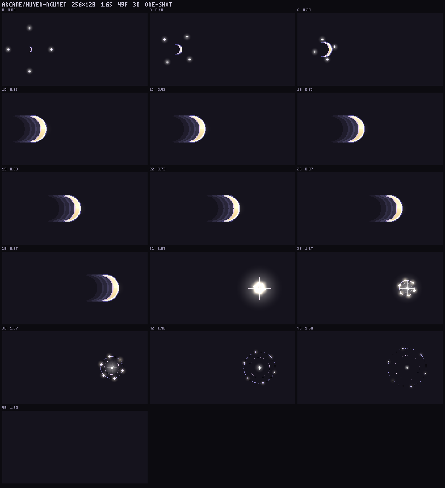

# Huyền Nguyệt — VFX 1.1.8

## Hướng hình ảnh

Dựa trên ảnh tham khảo người dùng cung cấp: thân trăng trắng ngà/kem vàng, bóng hồng tím, viền lam tím, sao bốn cánh thưa. Không sao chép sprite của game khác. Nguồn engine CombatGods của Turbo được giữ nguyên.

- Màu chính: #FFF1C9; sáng #FFFDF0; bóng #F3DBA6 / #D6BDE6; viền #948BD1 / #514B91.
- Nguyệt nhận: thân dày, khoét lệch để hai đầu nhọn, bay theo hướng đòn đánh; dư ảnh tím.
- Trăng tròn: ba cụm bóng lớn, viền sáng theo bậc pixel, không thêm nhiễu hạt.
- Va chạm: sao bốn cánh và vòng tím nở; không thêm dừng thời gian toàn bản đồ.

## Đã nối vào game

- Hue riêng cho Huyền Nguyệt khi Element.School; preset nguyên tố và phái khác giữ nguyên.
- SchoolStyle: ánh sao nhẹ, đường dư ảnh khi di chuyển, dấu va chạm, trăng nhỏ tụ ở tay. Dùng nhịp/throttle và kiểm tra hiển thị sẵn có.
- SwordWave của Huyền Nguyệt dùng sprite màu; Nguyệt Khuyết và Tam Trọng dùng cỡ lớn. Màu renderer trắng để không nhuộm mất bảng màu.
- Nguyệt Khuyết giữ dư ảnh mỗi 0,07 giây. Các kiếm khí thường vẫn dùng đường trail gốc, không tăng số dư ảnh lớn cho mọi đòn.
- Trụy Thế/Vĩnh Dạ dùng sprite trăng tròn mới. Trụy Thế tăng tốc rơi ở vị trí hình ảnh; thời điểm chạm, điểm thả và vùng gây sát thương không đổi.

MoonArt tạo tối đa 3 sprite crescent, 1 trăng tròn và 1 sao theo nhu cầu, cache dùng lại; không tạo texture mỗi frame. Dùng pool native, không thêm scan Actor hoặc vòng update toàn map.

## Chưa thay thế

Chưởng vẫn dùng hình nắm đấm/áp lực native; chín nguyệt cầu, beam và các vùng Forge vẫn dùng renderer native với bộ màu mới. Đây chưa phải sprite/hoạt ảnh độc lập cho từng thế. Không đổi AI, planner, hitbox, damage, mana, cooldown hay phản ứng gián đoạn.

## Xem và sửa



Đây là mô phỏng phong cách bằng PixelFX, không phải ảnh chụp game. Dùng vòng render–xem–chỉnh qua ba lượt: sửa silhouette, bỏ dither ở dư ảnh, chỉnh xung kích và kiểm tra biên canvas. Source thử: [huyen-nguyet.js](Previews/huyen-nguyet.js).

Từ gốc workspace:

```powershell
node Tools/pixelfx/tools/render.mjs arcane/huyen-nguyet --sheet
node Tools/pixelfx/tools/check.mjs arcane/huyen-nguyet
```

Source thử nhập thư viện PixelFX tại checkout Tools/pixelfx, không chạy trong mod. Nó là bản nghiên cứu riêng, không port toàn bộ timeline demo sang game; game giữ choreography native.

Chỉnh sprite game tại Code/Choreo/MoonArt.cs; bảng màu hiệu ứng chung tại Code/Choreo/Hue.cs; nhịp trang trí tại SchoolStyle.cs. Không sửa Shot radius hoặc Plan để đổi hình.

## Kiểm tra

Biên dịch bằng WorldBox/NML đã cài: đạt. Kiểm tra 36 thế, parser, giới hạn hazard, tính trong suốt, silhouette và pixel màu: đạt. PixelFX check: đạt, không cảnh báo.

Cần khởi động lại game để nạp code; trao phái thủ công, thử Nguyệt Khuyết và hai thế God. Quan sát trên đất sáng/tối, nhiều NPC, pause/đổi world, chết giữa chiêu. Chưa đo FPS hoặc xác minh VFX trong WorldBox; kiểm tra offline không chứng minh hết lag.
